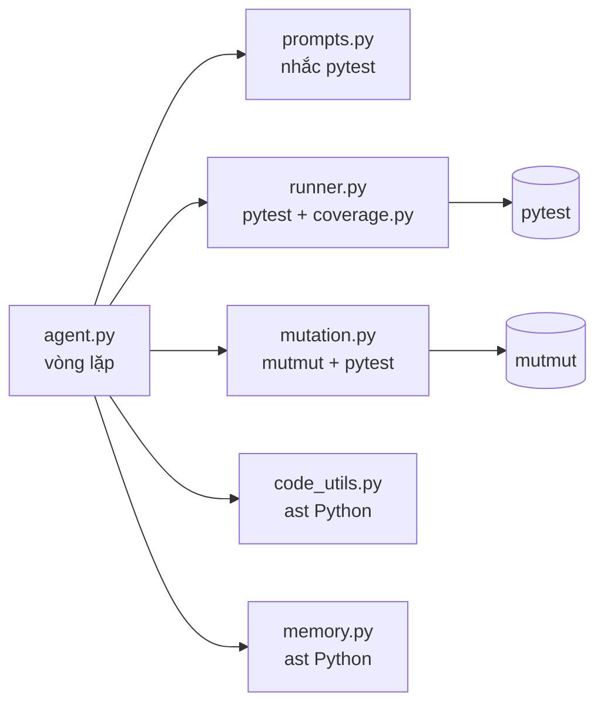
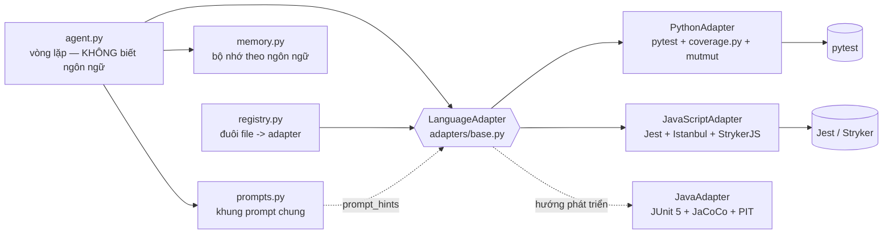

# Kế hoạch refactor: từ "chỉ Python" sang "đa ngôn ngữ" (kiến trúc Adapter)

> Nhánh git: `multi-language`. Tên đề tài mới: *"LLM Agent tự sinh unit test đa ngôn ngữ với vòng lặp tự cải tiến
> dựa trên phản hồi coverage và mutation testing"*. Ngôn ngữ hiện thực: **Python** và **JavaScript/TypeScript**.

## 1. Phân tích hiện trạng: chỗ nào đang gắn chặt với Python?

Vòng lặp agent (`testgen/agent.py`) về **ý tưởng** là độc lập ngôn ngữ: *sinh → chạy → đo → phân loại/sửa → bổ sung*.
Nhưng **cài đặt** gọi thẳng các công cụ Python ở nhiều chỗ:

| # | File | Chỗ gắn chặt | Gắn với gì | Cách xử lý |
|---|------|--------------|------------|------------|
| 1 | `testgen/runner.py` | `run_tests()`: gọi `python -m pytest ... --cov --junitxml`, đặt tên file `test_<module>.py`, `PYTHONPATH` | pytest, pytest-cov, junit XML | Chuyển vào `PythonAdapter.run_tests()` |
| 2 | `testgen/runner.py` | `parse_junit()`, `parse_coverage()` (định dạng `cov.json` của coverage.py) | định dạng báo cáo của pytest/coverage.py | Chuyển vào `PythonAdapter` |
| 3 | `testgen/runner.py` | `describe_missing()`: nhánh dạng cặp `[từ dòng, tới dòng]`, số âm = thoát hàm | định dạng nhánh của coverage.py | Thành phương thức adapter (JS có định dạng nhánh khác) |
| 4 | `testgen/runner.py` | mã thoát 2/3/4/5 của pytest = lỗi thu thập | quy ước của pytest | `PythonAdapter` |
| 5 | `testgen/mutation.py` | `generate_mutants()` dùng `mutmut.list_mutations/mutate`, bỏ mutant docstring bằng `ast` | mutmut 2.5.1, `ast` | `PythonAdapter.run_mutation()` |
| 6 | `testgen/mutation.py` | `_run_one()`: chạy `pytest -x` trên từng mutant | pytest | `PythonAdapter` |
| 7 | `testgen/code_utils.py` | `merge_tests`, `get_functions_code`, `remove_functions`, `test_function_names`, `add_suspected_marker` (`@pytest.mark.xfail`), `suspected_tests`, `is_valid_python` — đều dùng `ast` của Python | cú pháp Python + pytest | Thành các thao tác "sửa file test" của adapter; JS cần bộ phân tích riêng |
| 8 | `testgen/code_utils.py` | `extract_code()` chỉ nhận khối ` ```python ` | tên ngôn ngữ trong khối code | Nhận mọi thẻ ngôn ngữ (` ```js `, ` ```ts `…) |
| 9 | `testgen/prompts.py` | `SYSTEM_PROMPT` ("kỹ sư Python", "pytest", `pytest.raises`, `pytest.approx`), khối ` ```python `, "Lỗi khi chạy pytest", "decorator `@pytest.mark.xfail`", ví dụ `is` trong mutation prompt | pytest | Tách phần riêng từng ngôn ngữ thành `prompt_hints()` của adapter; prompt chung chỉ còn khung |
| 10 | `testgen/memory.py` | `module_tags()` dùng `ast` của Python; mẫu test in trong ` ```python `; bộ nhớ không phân biệt ngôn ngữ | `ast`, pytest | Nhãn module do adapter tính; bộ nhớ chia theo ngôn ngữ; chuyển đổi file memory cũ |
| 11 | `testgen/generator.py` | `TARGETS_DIR.glob("*.py")`, tên file `test_<module>.py` | đuôi `.py` | Registry nhận diện theo đuôi file; tên file test do adapter quyết định |
| 12 | `testgen/agent.py` | gọi trực tiếp `run_tests`, `run_mutation_testing`, `cu.merge_tests`, `cu.add_suspected_marker`, `cu.is_valid_python`, `module_tags`; lưu `test_<module>.py` | tất cả các mục trên | Agent chỉ gọi `self.adapter.*` |
| 13 | `evaluate.py` | `TARGETS_DIR / f"{module}.py"`, `FIXED_DIR / f"{module}.py"`, danh sách `MODULES` cố định | đường dẫn + đuôi `.py` | Danh sách module theo ngôn ngữ; kết quả/biểu đồ tách theo ngôn ngữ |
| 14 | `app.py` | `TARGETS_DIR.glob("*.py")`, ô "Dán code Python", `st.code(language="python")`, tô đỏ bằng `ast` | Python | Chọn/tự nhận diện ngôn ngữ; hiển thị qua adapter |
| 15 | `generated_tests/conftest.py`, `tests/test_targets.py`, `tests/test_memory.py`, `tests/test_evaluate.py` | đường dẫn `targets/<module>.py` | đường dẫn cố định | Cập nhật khi chuyển target Python vào `targets/python/` |
| 16 | `requirements.txt` | pytest, pytest-cov, mutmut | công cụ Python | Giữ nguyên; thêm `package.json` cho Node.js |

Những phần **đã độc lập ngôn ngữ**, giữ nguyên: `config.py`, `llm_client.py` (trừ câu trả lời mock mặc định),
`extract_lesson`, `extract_json`, `number_lines`, logic quyết định trong vòng lặp agent, cách lưu log, thiết kế
thực nghiệm (ghép cặp A/B/C/D, chấm held-out).

## 2. Kiến trúc

### Trước refactor


### Sau refactor


Agent nói chuyện với **một giao diện chung**; mỗi ngôn ngữ là một "phích cắm" (Adapter). Thêm ngôn ngữ mới =
viết thêm một lớp adapter + đăng ký đuôi file, **không sửa vòng lặp agent**.

### Giao diện `LanguageAdapter` (adapters/base.py)

| Phương thức | Ý nghĩa |
|---|---|
| `name`, `file_extensions`, `code_fence` | tên ngôn ngữ, đuôi file (`.py` / `.js`, `.ts`), thẻ khối code cho LLM |
| `check_environment()` | kiểm tra công cụ đã cài; trả về lỗi rõ ràng + lệnh cài đặt |
| `test_file_path(source_file)` | quy ước tên/vị trí file test (`test_x.py` / `x.test.js`) |
| `prompt_hints()` | hướng dẫn riêng cho LLM: framework, cú pháp import, cách viết ngoại lệ, nhãn nghi bug |
| `run_tests(...) -> TestResult` | chạy bộ test (có timeout, thư mục tạm), kèm coverage |
| `get_coverage(...) -> CoverageResult` | line %, branch %, dòng/nhánh chưa phủ |
| `run_mutation(...) -> MutationResult` | mutation score, danh sách mutant còn sống |
| Thao tác sửa file test | `test_names`, `get_tests_code`, `remove_tests`, `merge_tests`, `add_suspected_marker`, `suspected_tests`, `is_valid` |
| `module_tags(source)` | nhãn đặc điểm module cho bộ nhớ |

Dataclass kết quả **dùng chung**: `TestCaseResult`, `TestResult` (tái sử dụng `RunResult` cũ, giữ tên cũ làm bí danh),
`CoverageResult`, `Mutant`, `MutationResult` (tái sử dụng), `EnvironmentStatus`.

Quyết định cho JavaScript/TypeScript (chi tiết ở Bước 4):
- **Jest** + `babel-jest` (preset-env + preset-typescript): chạy cả `.js` và `.ts` mà không cần kiểm tra kiểu.
- Coverage: Istanbul có sẵn trong Jest, đọc `coverage-final.json`.
- Mutation: **StrykerJS** (`@stryker-mutator/jest-runner`), đọc báo cáo JSON. Không cài / lỗi → "không khả dụng",
  agent vẫn chạy phần coverage.
- Nhãn nghi bug: `test.failing(...)` + comment `// SUSPECTED_BUG: ...` (tương đương `xfail` của pytest).
- Sửa file test: Python dùng `ast`; JS dùng bộ quét ngoặc đơn giản (bỏ qua chuỗi/comment/regex) để tìm từng khối
  `test('tên', ...)` cấp cao nhất — không cần cài parser JS.

## 3. Thứ tự thực hiện (mỗi bước một commit, chạy kiểm tra hồi quy Python sau mỗi bước)

1. **Bước 1** — phân tích (tài liệu này) + chụp baseline `docs/baseline_truoc_refactor.json`.
2. **Bước 2** — `adapters/base.py`, `adapters/registry.py`, dataclass chung. Chưa đổi hành vi.
3. **Bước 3** — chuyển logic Python vào `adapters/python_adapter.py`; `agent.py`, `generator.py`, `prompts.py` chỉ
   làm việc qua adapter. `runner.py`/`mutation.py` còn lại là "cổng chung" (chọn adapter theo đuôi file + CLI).
   So sánh với baseline.
4. **Bước 4** — `adapters/javascript_adapter.py`, `package.json`, `targets/javascript/` (có bug), chuyển target Python
   vào `targets/python/`. Chạy agent thật trên từng module JS.
5. **Bước 5** — bộ nhớ theo ngôn ngữ, chuyển đổi file memory cũ.
6. **Bước 6** — `evaluate.py` đa ngôn ngữ, biểu đồ theo ngôn ngữ + so sánh 2 ngôn ngữ, tham số chạy nhanh.
7. **Bước 7** — `app.py`: chọn/tự nhận diện ngôn ngữ, REPLAY có log JS mẫu.
8. **Bước 8** — slide, lời thoại, `docs/THEM_NGON_NGU_MOI.md`, README, DEMO_CHECKLIST, CLAUDE.md, HOC_TAP.
9. **Bước 9** — kiểm tra toàn bộ từ đầu, tổng kết.

## 4. Cách chứng minh "không làm hỏng Python"

`scripts/snapshot_python.py` chụp hành vi phần Python, chạy lại sau mỗi bước với `--compare`:

| Kiểm tra | Tất định? | Tiêu chí sau refactor |
|---|---|---|
| Mã băm 8 prompt (system, initial, sửa lỗi, phân loại, coverage, mutation…) | Có | **Giống hệt** — LLM nhận đúng nội dung như cũ |
| Chạy lại bộ test trong log thực nghiệm (grading, shopping_cart; bản đầu + bản cuối): pass/fail, coverage, dòng chưa phủ | Có | **Giống hệt** |
| Mutation testing trên các bộ test đó: trạng thái **từng** mutant | Có | **Giống hệt** |
| Agent với LLM giả lập theo kịch bản (sửa cú pháp → phân loại → sửa → coverage → mutation) | Có | **Giống hệt** chuỗi hành động + kết quả |
| 64 test của công cụ (`pytest`) | Có | Vẫn pass (chỉ sửa import/đường dẫn nếu file bị chuyển) |
| `python evaluate.py --measure-only` | Có | Tái lập đúng `results/results.csv` lượt 1 |
| Agent với LLM thật trên `grading` (+ mutation) | **Không** (LLM ngẫu nhiên) | Chạy đủ các bước; kết quả tương đương |

Đã chạy script 2 lần liên tiếp trước refactor: phần tất định cho kết quả giống hệt nhau → dùng được làm mốc.

## 5. Rủi ro và cách giảm

| Rủi ro | Mức | Cách giảm |
|---|---|---|
| Refactor làm đổi prompt Python một chút (dấu cách, xuống dòng) → LLM cư xử khác, số liệu cũ không còn so sánh được | Cao | So mã băm prompt với baseline sau mỗi bước |
| Chuyển file target làm hỏng đường dẫn trong test/evaluate/app/log cũ | Trung bình | Tên module giữ nguyên; `evaluate` tìm module theo tên + ngôn ngữ; chạy `--measure-only` để đối chiếu |
| Không có parser JS trong Python → tách/ghép test JS sai | Trung bình | Bộ quét ngoặc có xử lý chuỗi, template literal, comment, regex; yêu cầu LLM viết `test()` cấp cao nhất (không `describe`); unit test riêng cho bộ quét |
| StrykerJS chậm / lỗi trên Windows | Trung bình | Chạy trong thư mục tạm trong dự án; timeout tổng; lỗi → `available=False`, agent dừng phase mutation êm |
| Jest ESM/TypeScript cấu hình phức tạp | Trung bình | Dùng babel-jest (chuyển mã, không kiểm tra kiểu) — một cấu hình cho cả `.js` và `.ts` |
| Hạn mức LLM: model miễn phí chỉ 50 request/ngày (hôm nay còn 10), key không còn credit cho model trả phí | **Cao** | Phần lớn kiểm chứng dùng phép đo tất định + LLM giả lập; lần chạy thật được chia qua nhiều ngày; ghi rõ số lượt đã chạy |
| Test do LLM sinh cho JS chạy code tuỳ ý trên máy | Thấp (đồ án) | Giống Python: thư mục tạm + timeout, **không** phải sandbox bảo mật (ghi trong hạn chế) |
