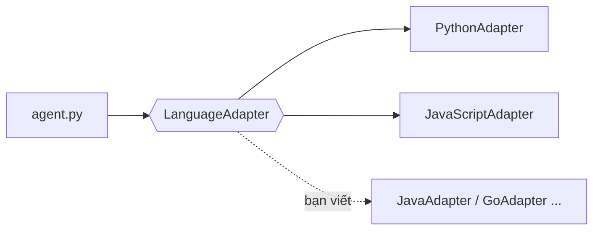

# Thêm một ngôn ngữ mới cho agent

Agent (`testgen/agent.py`) **không biết** mình đang sinh test cho ngôn ngữ nào: mọi việc phụ thuộc ngôn ngữ đi qua
một đối tượng `LanguageAdapter` (`adapters/base.py`). Thêm ngôn ngữ = viết **một lớp con** + **một dòng đăng ký**.
Không phải sửa vòng lặp agent, prompt, bộ nhớ, `evaluate.py` hay giao diện.



## 1. Các bước

1. Tạo `adapters/<ngon_ngu>_adapter.py`, viết lớp kế thừa `LanguageAdapter`, khai báo:
   `name`, `display_name`, `file_extensions`, `test_framework`, `coverage_tool`, `mutation_tool`,
   `code_fence_tags`, `code_markers`.
2. Cài các phương thức (bảng dưới). Python sẽ báo lỗi ngay khi tạo đối tượng nếu thiếu phương thức bắt buộc.
3. Đăng ký trong `adapters/__init__.py`: `register(JavaAdapter())`.
4. Thêm module mục tiêu vào `targets/<ngon_ngu>/` (+ bản đã sửa bug vào `evaluation/fixed_targets/<ngon_ngu>/`),
   thêm danh sách module vào `LANGUAGES` trong `evaluate.py`.
5. Viết test cho adapter (xem `tests/test_javascript_adapter.py` làm mẫu), chạy agent với LLM giả lập (`mock`)
   trước, rồi mới chạy LLM thật.

| Phương thức | Bắt buộc | Việc cần làm | Gợi ý |
|---|---|---|---|
| `check_environment()` | ✔ | kiểm tra công cụ đã cài; **không ném lỗi**, trả `EnvironmentStatus` + lệnh cài | gọi `java -version`, kiểm tra file jar/thư viện |
| `test_file_path(src, out_dir)` | ✔ | quy ước tên file test | `Cart.java` → `CartTest.java` |
| `prompt_hints(src)` | ✔ | 12 đoạn chữ riêng của ngôn ngữ (xem `testgen/prompts.py`) | chép `JS_HINTS` rồi sửa |
| `run_tests(src, code, timeout, with_coverage, deselect)` | ✔ | chạy test trong thư mục tạm có timeout → `TestResult` (+ coverage) | đọc báo cáo XML/JSON, KHÔNG đọc chữ trên màn hình |
| `run_mutation(src, code, max_mutants, seed, ...)` | ✔ | chạy mutation → `MutationResult`; công cụ lỗi → `available=False` | lấy mẫu `max_mutants` bằng `random.Random(seed)` như 2 adapter có sẵn |
| `is_valid`, `test_names`, `get_tests_code`, `remove_tests`, `merge_tests` | ✔ | đọc/sửa file test theo **từng test** | parser thật của ngôn ngữ hoặc bộ quét ngoặc như `js_edit.py` |
| `add_suspected_marker`, `suspected_tests` | ✔ | gắn/đọc nhãn "nghi bug" (test vẫn giữ nguyên, bộ test vẫn xanh) | xem mục 3 |
| `describe_missing(source, result)` | | mô tả dòng/nhánh chưa phủ cho LLM | mặc định chỉ liệt kê dòng |
| `unmark_suspected`, `module_tags`, `test_line_spans`, `base_test_name` | | bỏ nhãn khi chấm trên bản sửa; nhãn cho bộ nhớ; tô màu trên giao diện | có giá trị mặc định |

## 2. Phác thảo cho Java: JUnit 5 + JaCoCo + PIT (chưa hiện thực)

```python
class JavaAdapter(LanguageAdapter):
    name, display_name, file_extensions = "java", "Java", (".java",)
    test_framework, coverage_tool, mutation_tool = "JUnit 5", "JaCoCo", "PIT (pitest)"
    code_fence_tags = ("java",)
    code_markers = ("@Test", "import ")

    def check_environment(self):
        # java -version (>= 17), mvn -v (hoặc các file jar: junit-platform-console-standalone, jacocoagent, pitest)
        ...

    def test_file_path(self, source_file, out_dir=None):
        src = Path(source_file)                      # Cart.java -> CartTest.java
        return Path(out_dir or src.parent) / f"{src.stem}Test.java"

    def prompt_hints(self, source_file=None):
        return dict(JS_HINTS, language="Java", framework="JUnit 5", fence="java", spec="Javadoc",
                    import_rule="Lớp cần test cùng package mặc định; import org.junit.jupiter.api.*",
                    structure_rule="Một lớp <Tên>Test, mỗi test là một phương thức @Test void tenMoTa()",
                    assert_rule="assertEquals / assertThrows(LoaiLoi.class, () -> ...) / assertEquals(a, b, 1e-9)",
                    keep_marker="giữ nguyên các chú thích // SUSPECTED_BUG và @Disabled nếu có",
                    test_id="tên phương thức test", keep_name="GIỮ NGUYÊN TÊN PHƯƠNG THỨC TEST",
                    test_unit="phương thức @Test")

    def run_tests(self, source_file, test_code, timeout=60, with_coverage=True, deselect=None):
        # 1. thư mục tạm: src/main/java/Cart.java + src/test/java/CartTest.java + pom.xml mẫu
        # 2. mvn -q test (plugin jacoco-maven-plugin) — hoặc javac + java -jar junit-console --reports-dir
        # 3. đọc target/surefire-reports/TEST-*.xml (định dạng JUnit XML: giống parse_junit() bên Python!)
        # 4. đọc target/site/jacoco/jacoco.xml: <line nr="12" mi="0" ci="3" mb="1" cb="1"/>
        #    mi = lệnh chưa chạy, mb/cb = nhánh chưa/đã đi qua -> line %, branch %, missing_lines
        ...

    def run_mutation(self, source_file, test_code, max_mutants=20, seed=0, timeout=30, **kw):
        # mvn org.pitest:pitest-maven:mutationCoverage -DoutputFormats=XML
        # đọc target/pit-reports/mutations.xml: <mutation detected="true" status="KILLED"> <lineNumber>,
        #   <mutator>, <description>  -> Mutant(id, line, original, mutated=description, status)
        # PIT: KILLED/TIMED_OUT -> killed/timeout; SURVIVED/NO_COVERAGE -> survived; bỏ NON_VIABLE
        ...

    # Sửa file test: Java không cho hàm ở cấp cao nhất -> các test nằm TRONG lớp CartTest.
    #   Có thể dùng bộ quét ngoặc như js_edit.py nhưng tìm các khối "@Test ... void ten(...) { ... }"
    #   ở độ sâu 1 (bên trong lớp), hoặc gọi thư viện javaparser qua một tiến trình Java nhỏ.
    # Nhãn nghi bug: JUnit 5 không có "expected failure" như xfail/test.failing. Hai lựa chọn:
    #   (a) @Disabled("SUSPECTED_BUG: ...")  -> đơn giản nhưng test KHÔNG chạy nữa (mất khả năng phát hiện khi bug được sửa)
    #   (b) bọc thân test: assertThrows(AssertionError.class, () -> { ...thân cũ... })  -> giống test.failing (strict)
```

Khó khăn dự kiến với Java (vì sao chưa làm trong đồ án):
- **Chậm**: mỗi lần chạy Maven + JVM mất 5–15 giây; PIT chậm hơn Stryker/mutmut → vòng lặp agent chậm hơn nhiều.
- **Biên dịch**: test sai kiểu dữ liệu là lỗi biên dịch cả file (Python/JS chỉ lỗi lúc chạy từng test) → phase
  "sửa file hỏng" sẽ được gọi nhiều hơn.
- **Không có "expected failure"** chuẩn → cách gắn nhãn nghi bug phải tự chế (mục (b) ở trên).

## 3. Ước lượng công sức (dựa trên kinh nghiệm làm adapter JavaScript)

| Việc | JavaScript (đã làm) | Java (ước lượng) |
|---|---|---|
| Cài công cụ + thử chạy tay (Jest, Stryker / Maven, JaCoCo, PIT) | ~0,5 ngày | ~1 ngày |
| `run_tests` + đọc báo cáo test/coverage | ~0,5 ngày | ~0,5 ngày (JUnit XML giống pytest) |
| `run_mutation` | ~0,5 ngày | ~1 ngày |
| Đọc/sửa file test theo từng test (không có `ast`) | ~1 ngày (bộ quét ngoặc + test) | ~1–1,5 ngày (test nằm trong lớp) |
| Prompt hints + chạy thử với LLM, sửa lỗi phát sinh | ~0,5 ngày | ~1 ngày |
| Module mục tiêu + bug + bản sửa | ~0,5 ngày | ~0,5 ngày |
| **Tổng** | **~3,5 ngày** | **~5–6 ngày** |

Phần **không phải viết lại**: vòng lặp agent, oracle problem (phân loại TEST_WRONG / SUSPECTED_BUG), bộ nhớ, thực
nghiệm A/B/C/D + chấm held-out, giao diện, REPLAY. Đó chính là lợi ích của kiến trúc Adapter.
