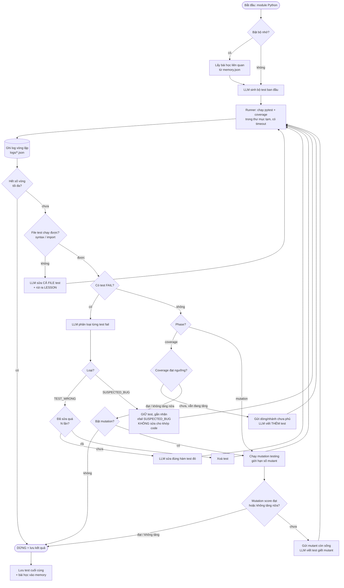

# Sơ đồ luồng của agent (vòng lặp tự cải tiến)

Xem sơ đồ: mở file này trên GitHub/GitLab, VS Code (extension "Markdown Preview Mermaid Support")
hoặc dán vào https://mermaid.live.

## Chú thích
- **Mỗi mũi tên quay về "Runner" là một vòng lặp.** Mỗi vòng thường tốn 1 lần gọi LLM
  (riêng bước phân loại + sửa test tốn 2 lần).
- **Thứ tự ưu tiên:** sửa file hỏng → xử lý test fail → tăng coverage → giết mutant. Không tăng coverage khi còn
  test fail, vì coverage của một bộ test "đỏ" không đáng tin.
- **Điều kiện dừng:** đạt ngưỡng, không cải thiện sau `patience` lần thử liên tiếp, hết `max_iterations`,
  hoặc lỗi gọi LLM (dừng êm, giữ bộ test tốt nhất).
