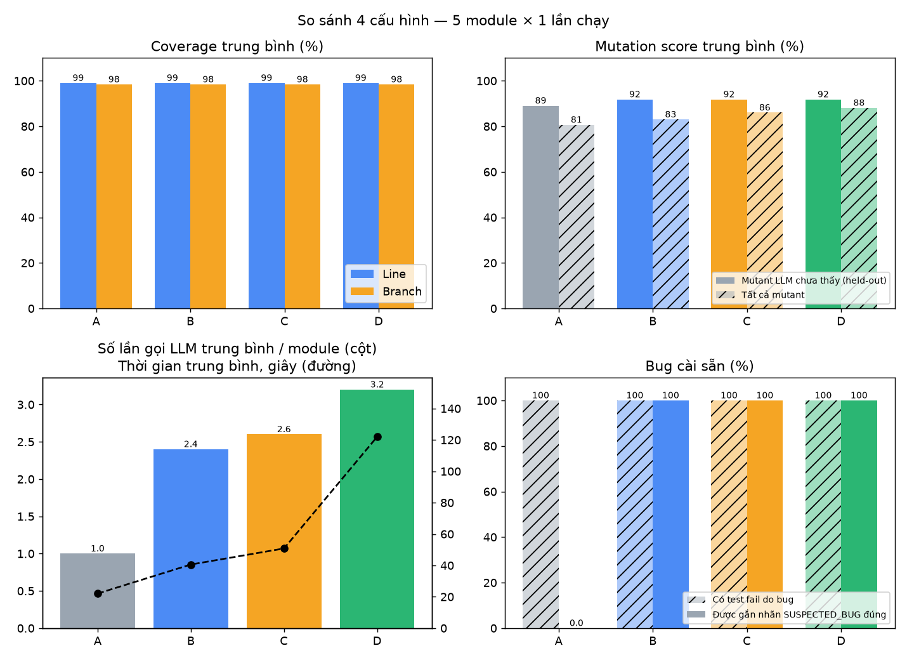

<!-- _paginate: false -->

# LLM Agent tự sinh unit test cho Python

### Vòng lặp tự cải tiến dựa trên phản hồi coverage và mutation testing

<br>

Sinh viên: ……………… · MSSV: ………………
Giảng viên hướng dẫn: ………………
Môn: ……………… · 2026

---

## 1. Vấn đề

- Viết unit test **tốn thời gian**, hay bị bỏ qua
- LLM viết test rất nhanh, **nhưng**:
  - test có thể **không chạy được** (sai import, sai cú pháp)
  - test có thể **thiếu** nhánh quan trọng
  - test có thể **sai**, hoặc tệ hơn: **"hợp thức hoá" bug**
    ```python
    assert letter_grade(80) == "C"   # code sai, test viết theo code sai
    ```
- ❓ Làm sao để LLM **tự kiểm tra và cải thiện** bộ test của nó?

---

## 2. Các hướng tiếp cận hiện có

| Hướng | Ví dụ | Ưu | Nhược |
|---|---|---|---|
| Tìm kiếm / tiến hoá | **EvoSuite** (Java), **Pynguin** (Python) | coverage cao, có hệ thống | assert "chụp" hành vi hiện tại, test khó đọc |
| LLM sinh một lần | ChatGPT, Copilot | test dễ đọc, hiểu docstring | không kiểm chứng, hay lỗi |
| **LLM + phản hồi** | CoverUp, MuTAP, TestPilot… | kết hợp cả hai | tốn nhiều lần gọi LLM |

➡️ Đồ án đi theo hướng **LLM + vòng lặp phản hồi**, tự cài đặt đơn giản để hiểu rõ từng bước.

---

## 3. Mục tiêu và phạm vi

**Mục tiêu**
- Agent sinh test pytest → **chạy, đo** → dùng kết quả đo để **tự sửa / bổ sung**
- Xử lý **oracle problem**: test fail là do *test sai* hay *code sai*?
- So sánh định lượng 4 cấu hình

**Phạm vi**
- Python, 5 module nhỏ (dễ → khó), **2 bug cài sẵn**
- Không dùng LangChain / framework agent — vòng lặp tự viết
- LLM qua API (OpenRouter / DeepSeek / OpenAI / Claude / Ollama)

---

## 4. Kiến trúc

```
            ┌──────────────┐   prompt    ┌─────────┐
 module ──► │    AGENT     │ ──────────► │   LLM   │
 (.py)      │ (vòng for +  │ ◄────────── │         │
            │   if/else)   │   code test └─────────┘
            └──────┬───────┘
     code test     │  ▲  RunResult / MutationResult
                   ▼  │
            ┌───────────────┐   ┌──────────────┐   ┌──────────────┐
            │ Runner        │   │ Mutation     │   │ Memory       │
            │ pytest+cov    │   │ mutmut ops   │   │ JSON bài học │
            │ (subprocess)  │   │ (song song)  │   │ + mẫu test   │
            └───────────────┘   └──────────────┘   └──────────────┘
      logs/*.json  ──►  Streamlit (chạy trực tiếp / REPLAY)
```

---

## 5. Vòng lặp tự cải tiến

1. LLM **sinh** bộ test ban đầu
2. **Chạy** pytest + đo coverage
3. File lỗi cú pháp/import → LLM **sửa cả file**
4. Test fail → LLM **phân loại**:
   - `TEST_WRONG` → sửa test đó
   - `SUSPECTED_BUG` → <span class="red">GIỮ test</span>, gắn nhãn `xfail` — không sửa cho khớp code
5. Coverage < ngưỡng → gửi **dòng/nhánh chưa phủ** → LLM viết thêm
6. Mutation score < ngưỡng → gửi **mutant còn sống** → LLM viết thêm
7. Dừng: đạt ngưỡng · không cải thiện 2 lần · hết số vòng

<span class="small">LLM chỉ trả về hàm mới/đã sửa; chương trình tự ghép bằng `ast` → LLM không thể xoá test cũ.</span>

---

## 6. Coverage — ví dụ

```python
def pass_status(score, attendance_rate):
    if attendance_rate < 0.7:      # nhánh True / False
        return "CẤM THI"
    if score >= 50:
        return "ĐẬU"
    ...
```

- Test `pass_status(80, 0.9)` → chạy qua dòng 2, 4, 5
- **Line coverage**: bao nhiêu % dòng được chạy
- **Branch coverage**: bao nhiêu % *nhánh* (True/False) được đi qua
- Agent gửi cho LLM: *"Nhánh từ dòng 2 sang `return "CẤM THI"` chưa được đi qua"*

---

## 7. Mutation testing — ví dụ

Coverage 100% ≠ test tốt. **Mutant** = code bị sửa nhẹ một chỗ:

```python
if score >= 90: return "A"     ─►     if score > 90: return "A"     # mutant
```

| Test | Code gốc | Mutant | Kết luận |
|---|---|---|---|
| `letter_grade(95) == "A"` | pass | pass | mutant **sống sót** → test chưa đủ chặt |
| `letter_grade(90) == "A"` | pass | **fail** | mutant **bị giết** <span class="green">✓</span> |

**Mutation score** = mutant bị giết / tổng mutant

<span class="small">Dùng toán tử đột biến của mutmut 2.5.1 (mutmut 3 không chạy trên Windows); chỉ 1 module, tối đa 20 mutant, chạy song song 4 tiến trình.</span>

---

## 8. Bộ nhớ "tự học"

- File **JSON**, không dùng vector database
- Lưu **bài học sửa lỗi** (chỉ khi vòng sau xác nhận lỗi đã hết)
  và **mẫu test tốt** (làm tăng coverage / giết mutant)
- Chọn kinh nghiệm liên quan theo **nhãn AST** của module (`class`, `exception`, `branches`…) → chèn vào prompt

⚠️ "Học" = **học trong ngữ cảnh** (in-context learning):
trọng số LLM **không đổi**, chỉ có thêm "sổ tay kinh nghiệm" trong prompt.

---

## 9. Thiết lập thực nghiệm

| Cấu hình | Mô tả |
|---|---|
| **A** | Baseline — sinh test một lần |
| **B** | Agent + phản hồi coverage |
| **C** | B + mutation testing |
| **D** | C + bộ nhớ |

- 5 module · 2 bug cài sẵn · ngưỡng: line 95%, branch 90%, mutation 80%
- **Chấm lại công bằng**: cùng runner; mutation chấm trên mutant **LLM chưa thấy** (held-out)
- **Phát hiện bug** = test fail trên code lỗi **và** pass trên bản đã sửa
- Thiết kế ghép cặp: A, B lấy từ các mốc của lần chạy C (cùng prompt) → tiết kiệm lần gọi LLM
- LLM: `nemotron-3-super-120b` (miễn phí, OpenRouter) · **1 lần chạy** (giới hạn 50 request/ngày)

---

<style scoped>table { font-size: 0.68em; } li { font-size: 0.85em; }</style>

## 10. Kết quả

| Cấu hình | Line / branch | Mutation held-out | Test fail còn lại | Bug gắn nhãn đúng | Gọi LLM |
|---|---|---|---|---|---|
| **A** Baseline | 99 / 98 % | 89.1 % | 1.2 / module | 0 / 2 | 1.0 |
| **B** + coverage | 99 / 98 % | 91.8 % | **0** | **2 / 2** | 2.4 |
| **C** + mutation | 99 / 98 % | 91.8 % | **0** | **2 / 2** | 2.6 |
| **D** + memory | 99 / 98 % | 91.8 % | **0** | **2 / 2** | 3.2 |

- Coverage **đã bão hoà** ngay lần sinh đầu → khác biệt nằm ở **xử lý test fail**: 0 nhãn sai (FP)
- Mutation feedback chỉ tăng điểm trên **mutant đã đưa cho LLM** (83 → 86 %), **không** tăng trên mutant mới

<span class="small">5 module × 1 lần chạy — quan sát ban đầu, chưa có ý nghĩa thống kê.</span>

---

## 10. Kết quả (biểu đồ)



---

## 11. Demo

**Streamlit** — `streamlit run app.py`

1. Chọn `grading.py` → **Chạy agent** → xem từng vòng
2. LLM phân loại test fail là **SUSPECTED_BUG**: *"80 phải là B nhưng code dùng `> 80`"*
3. Tab **Code test**: test nghi bug được <span class="red">tô đỏ</span>, xem diff giữa các vòng
4. Biểu đồ coverage / mutation score qua các vòng

<span class="small">Dự phòng: chế độ **REPLAY** phát lại từ log JSON — không cần mạng.</span>

---

## 12. Hạn chế & hướng phát triển

**Hạn chế**
- **Thực nghiệm nhỏ**: 5 module tự viết, 1 model miễn phí (50 request/ngày), ít lần chạy
- LLM có thể **phân loại sai** → nhãn chỉ là *"nghi ngờ"*, cần người review
- Tối ưu mutation score có thể sinh test **bám chi tiết cài đặt** (`assert result is value`)
- Phụ thuộc **docstring**; bộ nhớ đơn giản; mutation score là **ước lượng** trên mẫu

**Hướng phát triển**
- Benchmark dự án thật, so sánh trực tiếp với **Pynguin**
- Bộ nhớ dùng **embedding**; lọc **mutant tương đương**; tích hợp **CI**

---

## 13. Kết luận

- Đã xây dựng agent **sinh → chạy → đo → sửa/bổ sung** hoàn chỉnh, không framework
- **Phản hồi thực thi** đưa test fail về 0, và **giữ lại test phát hiện bug** (gắn nhãn đúng 2/2)
  thay vì sửa cho khớp code sai
- **Mutation testing** lộ ra assert yếu mà coverage không thấy — nhưng test sinh để "giết" mutant
  **chưa** cải thiện trên mutant mới: phải chấm trên tập held-out mới thấy
- Đổi lại: **2.4–3.2× số lần gọi LLM** — và vẫn cần con người review nhãn SUSPECTED_BUG

<br>

### Cảm ơn thầy/cô đã lắng nghe! 🙏
